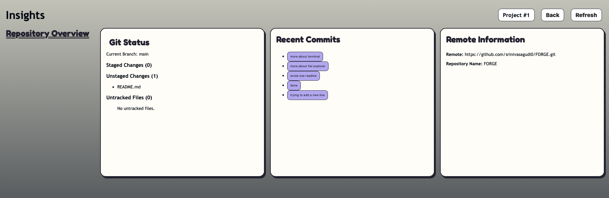

# FORGE

Forge is a local developer UI that I built to bring several coding tools together in one place.

## Features

Everything you need to build your app on a computer with no enough storage or who want work in a single place. 

- Project Dashboard
- - Add existing project
- - View your project in one places
- - See your project langs and created and updated date

- File Explorer
- - Browse your project files
- - Open and read files
- - edit and save files
- - jump between dirs

- Built in Terminal
- - Run commands in your project
- - Work from your project root dir
- - Just like a normal terminal but in your project root dir

- Git Insights
- - View your current git status
- - Check staged, usntaged and untracked files
- - Check your recents commits
- View your current branch and remote

This is the 1st version of FORGE. I was focusing to get everything running together correctly. I will be adding more inisights page and brand new features in the next version after I get some feedback from the users and reviewers.

## Ai declaration

I used Ai for 

- debugging: Help find what causes the errors and at the start for running commands to make the placeholder files.
- Learning: Explanations and implementatios for interactive terminal.
- Styling: Asking it to help me pick colors and styles for the UI.

I understand everyhting that is in this project and I have written all the code myself. I have used Ai to help me with the above mentioned tasks