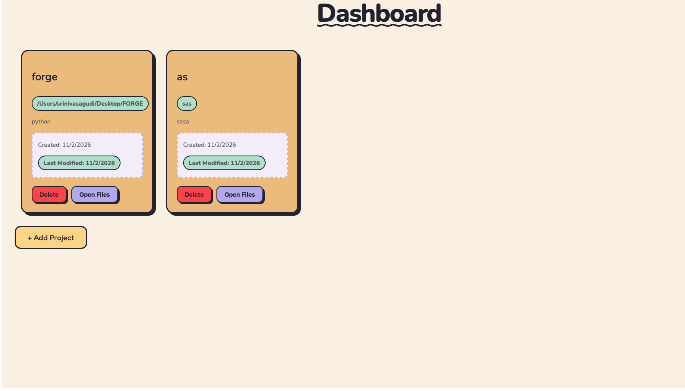
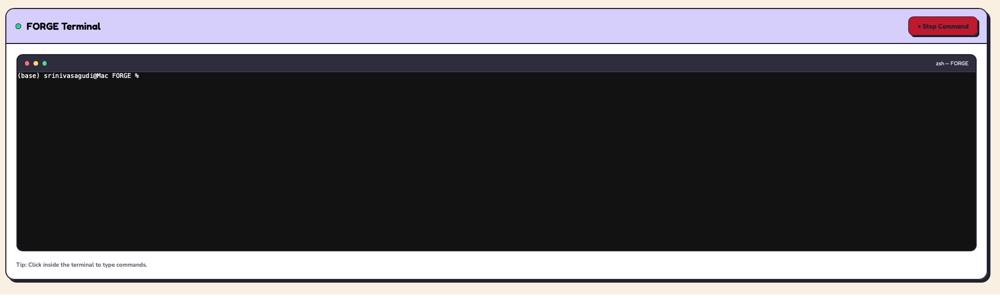

# FORGE

Forge is a local developer UI that I built to bring several coding tools together in one place.

## Features

Everything you need to build your app on a computer with no enough storage or who want work in a single place. 

- Project Dashboard
- - Add existing project
- - View your project in one places
- - See your project langs and created and updated date

- File Explorer
- - Browse your project files
- - Open and read files
- - edit and save files
- - jump between dirs

- Built in Terminal
- - Run commands in your project
- - Work from your project root dir
- - Just like a normal terminal but in your project root dir

