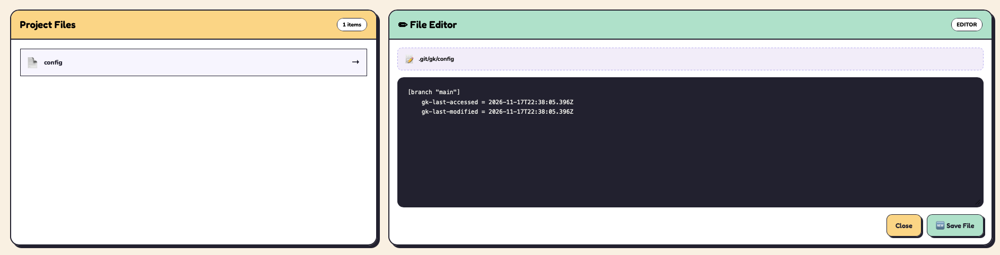

# FORGE

Forge is a local developer UI that I built to bring several coding tools together in one place.

## Features

Everything you need to build your app, even if your computer is full or you just want to work in one spot.

### Project Dashboard

- Add a project you already started
- See all your projects in one place
- Check what coding languages you used and when you last worked on them

### File Explorer

- Look through your project files
- Open and read your files
- Make changes and save your work
- Easily jump between different folders

### Built-in Terminal

- Run commands right inside your project
- Work directly from your main project folder
- Use it just like a normal terminal, but without having to switch screens

### Git Insights

- See what's happening with your code right now
- Check which files are ready to save, which ones are still being worked on, and any new ones
- Look back at your recent saves
- Easily see which branch you are working on and where it is saved online

This is the 1st version of FORGE. I was focusing to get everything running together correctly. I will be adding more inisights page and brand new features in the next version after I get some feedback from the users and reviewers.

## Ai declaration

I used Ai for 

- debugging: Help find what causes the errors and at the start for running commands to make the placeholder files.
- Learning: Explanations and implementatios for interactive terminal.
- Styling: Asking it to help me pick colors and styles for the UI.

I understand everyhting that is in this project and I have written all the code myself. I have used Ai to help me with the above mentioned tasks
